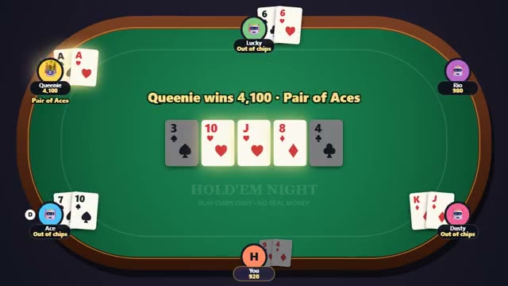

# Hold'em Night

Texas hold'em with friends. Play chips only. A multiplayer starter game from [Multiplayer Agent](https://multiplayeragent.com): 2D, turn-based, 2–8 players, with bots that fill empty seats.

## How it plays

Two cards each, five shared on the board: bet, call, raise or fold, and the best five-card hand takes the pot (side pots when someone is all-in). Chips are play chips only, with no real money and nothing to buy; run out and you just buy back in.

**Controls:** Click or tap Fold, Check/Call or Raise; drag the slider to size a raise (keys F, C, R).

## Make it yours in the Game Builder

Open the [Game Builder](https://multiplayeragent.com), choose **Start from a starter game** and pick Hold'em Night. It opens as version 1 in your studio, ready to play and publish. Then ask for changes, for example:

- Make the blinds go up every 10 hands
- Add a chat bubble so players can trash-talk
- Turn it into a space casino with neon chips

## Run it yourself

1. Get a free publishable key (`pk_…`) at [multiplayeragent.com](https://multiplayeragent.com).
2. In `index.html`, put it in place of `pk_REPLACE_ME` in the `MP_CONNECT` block.
3. Open `index.html` in a browser. No build step and no server needed.

Without a key it still runs, offline against bots.

## How it is built

- One `index.html`. The comment at the top of the script maps the code and explains the multiplayer.
- **Hidden info:** Your two cards are sealed so only you can read them (the host deals, so it can too).
- **Host-run rules:** The host's browser shuffles, deals, runs the betting and pays the pots; if it leaves, the next player takes over.
- **Bots:** Bots fill empty seats, play by hand strength and sometimes bluff; a friend who joins takes a bot's seat next hand.
- **Leaderboard:** The biggest pot each player has won.
- `?attract` runs it offline with bots only. The preview video is recorded from it.

## License

MIT.
